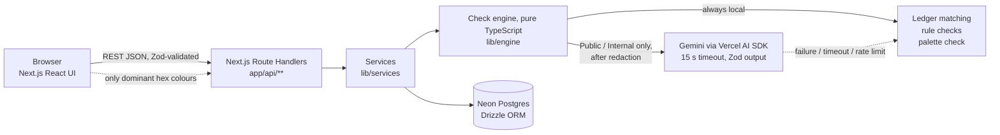

# Ledgerly

**Ledgerly helps content teams publish on-brand by verifying every claim against approved sources, and learns from reviewer decisions to make the brand guidelines clearer over time.**

Built by team **CookedCoders** (IIIT Kota) for **CodeNova India 2026, Round 2 ("The Build")**. Problem statement by Inkloom AI.

- **Live demo:** `TODO: https://<your-project>.vercel.app` (opens without sign-in)
- **Source:** https://github.com/Eduman1551/Ledgerly
- **Screenshot:** `TODO: docs/screenshot-review.png`

> The demo brand **Kesar & Co.** is **fictional**. All people, prices, facts and drafts in the seed data are made up for this demo.

---

## 3-minute judge walkthrough

1. Open the link and click **Start as Riya (Creator)**.
2. Open **Diwali launch post**. You will see 8 highlighted issues, each with its source, for example `₹499 → ₹549 · Price sheet v3`. The trust strip at the bottom of the panel says what was sent to AI (or "Checked locally · 0 data sent to AI").
3. Click **Accept** on the price fix. Use **Edit** on "India's #1" (or Accept: remove). Fix the other high-severity issues (or use **Accept all fixes**), click **Re-check**, then **Send to reviewer**.
4. Switch persona (top right) to **Arjun (Reviewer)**. Open the draft in the review queue, **Override** a tone flag with a reason, then **Approve**. The page shows "Approved, ready to publish" with **Copy final text**. Ledgerly never publishes.
5. Open **Winter Blend teaser brief** (Confidential). The trust strip says **"Checked locally · 0 data sent to AI"**.
6. Switch to **Meera (Admin)** → **Insights**. "Tone: avoid slang" shows as a vague rule (overridden 56% of the time). Click **Accept rewrite**, then open **Guidelines** to see version 2.
7. **Fact Ledger** → **New version** on "Masala Chai 250g price" (for example ₹599). Re-check a draft that says ₹549 and it is now flagged **Outdated**.

Judges share one database. **Demo tools → Reset demo data** restores the starting state at any time.

---

## What it does

| Pillar | What works in this build |
|---|---|
| **Claim Ledger (accuracy)** | A versioned Fact Ledger (value, source, owner, effective date, full history). Every claim in a draft is labelled **Supported / Unsupported / Outdated / Conflicting** with the exact fact version it was checked against. Rule: no source, no claim. |
| **Governance Brain (learning)** | Every accept, edit, override and approval is logged. Rules with ≥ 3 decisions and an override rate ≥ 40% are flagged as vague, with the override reasons as evidence and a proposed rewrite. Accepting the rewrite creates a new rule version that later checks use. |
| **Private by Design (trust)** | Three privacy tiers. Confidential drafts never reach AI. Internal drafts are reversibly redacted (names, emails, phones, internal codes, confidential fact values) before AI sees them. Confidential fact values are hidden from AI on every tier. A trust strip on every result says what was sent. |

Also: Hinglish/Hindi/English language detection, Hinglish-aware tone checks, banned and required terms, brand spelling, emoji and ALL-CAPS limits, language-per-channel, sentence length, image alt text and brand-palette colour checks.

### The 12-step workflow

| Stage | Steps | Where in the app |
|---|---|---|
| 1 Setup (Admin) | Upload brand docs → tag privacy tier → build the Fact Ledger | Guidelines → Import from brand doc, Fact Ledger |
| 2 Check (Ledgerly) | Creator submits → split into claims, route by tier → check every claim | Drafts → New draft, `POST /api/drafts/:id/check` |
| 3 Review (Humans) | See why and fix → accept or edit (re-checked) → reviewer approves or overrides with a reason | Draft review screen |
| 4 Learn (Brain) | Log decision → spot vague rules and repeat mistakes → accepted rewrite becomes a new guideline version | Insights, Guidelines version history |

---

## Architecture



**Check pipeline** (`lib/engine/pipeline.ts`):

1. **Language detection** (local): Devanagari share + a ~170-word romanised-Hindi list → english / hindi / hinglish / mixed.
2. **Tier routing**: Confidential → no AI. Internal → full redaction. Public → confidential fact values hidden. The placeholder map never leaves the server.
3. **Claim extraction**: local regex (₹/Rs prices, numbers, lakh/crore, %, durations incl. "din", dates, superlatives, certifications), merged with AI claims when AI ran. AI text is located in the draft by the server; spans the AI invents are dropped.
4. **Ledger matching** (always local, deterministic): find the nearest fact by label/alias, normalise values, compare with the current and older versions → Supported / Outdated / Conflicting / Unsupported.
5. **Rule checks** (local): banned terms, required spelling, slang, emojis, ALL-CAPS, language per channel, sentence length, alt text.
6. **Tone** (AI on allowed tiers): up to 3 off-brand phrases with a rewrite in the same language. Local fallback: the rule checks alone.
7. **Visual check**: the browser extracts dominant colours from an attached image; the server compares them with the palette using Delta-E (CIE76).
8. The check run stores the AI path, model, characters sent and redaction count. The trust strip text comes from this record.

---

## Main technical decisions

| Decision | Why |
|---|---|
| **One Next.js app** (Route Handlers as the Node.js REST backend) instead of a separate Node server | One repo, one deploy on Vercel, shared TypeScript types and Zod schemas between client and server. The pipeline is still a plain REST API (`/api/...`). |
| **Deterministic ledger matching; AI only for extraction and tone** | A fact check must be reproducible and explainable. The AI can help find claims, but it never decides whether a claim is true. |
| **Reversible redaction** | AI sees `[NAME_1]`, `[FACT_2]`; the server restores the originals locally. "Send the claim, not the document." |
| **Local fallback for every AI step** | No key, a timeout (15 s), a rate limit or invalid output never breaks a check. The trust strip says which path ran. |
| **No authentication; a persona switcher** | Organiser rule: every link opens without sign-in. Roles are still enforced on the server (only reviewers can override and approve, only admins can edit the ledger and rules). |
| **In-memory PGlite fallback** when `DATABASE_URL` is missing | A teammate, a judge or CI can run the app with zero setup. Production uses Neon. |
| **Versioned facts and rules, never overwritten** | "Outdated" is only possible if old values are kept, and every issue cites the exact version it was checked against. |

---

## Disclosure: APIs, AI models, libraries and templates

**AI model and API**
- **Google Gemini** (`gemini-3.8-flash` by default, set with `LLM_MODEL`) through the **Google AI Studio API** (free tier), called via the **Vercel AI SDK** (`ai`, `@ai-sdk/google`).

**Where AI is used**
- Claim extraction and tone review of drafts with tier Public or Internal (Internal text is redacted first).
- Optional "Polish wording with AI" on a proposed guideline rewrite (non-confidential rules only; sends the rule wording and override reasons, never a draft).
- Optional brand-document import (non-confidential documents only).

**Where AI is never used**
- Confidential drafts and documents. Ledger matching (deciding Supported / Outdated / Conflicting / Unsupported). Rule checks. The palette check. The vague-rule detector and its default rewrite (a local template built from the override reasons). Seeding and the eval's local mode.

**Libraries**: Next.js 16, React 19, TypeScript, Tailwind CSS v4, shadcn/ui (base-nova style, Base UI primitives), lucide-react, Recharts, sonner, Drizzle ORM and drizzle-kit, `@neondatabase/serverless`, `@electric-sql/pglite` (local fallback DB), Zod 4, mammoth (.docx parsing), dotenv, tsx, Vitest, ESLint.

**Templates**: `create-next-app` scaffold and shadcn/ui generated components (`components/ui/*`). No other templates.

**AI coding assistance**: parts of this codebase were written with the help of Claude Code (Anthropic), as shown in the commit trailers.

**Hosting**: Vercel (app), Neon (Postgres), GitHub (source and CI).

---

## Run it locally (Windows PowerShell)

Requirements: Node.js 22+ and pnpm.

```powershell
pnpm install
Copy-Item .env.example .env.local   # then fill in the values (all optional)
pnpm dev                             # http://localhost:3000
```

With no `DATABASE_URL`, the app starts an in-memory database with the demo data. To use Neon:

```powershell
pnpm db:push    # create the tables in the database from .env.local
pnpm db:seed    # load the Kesar & Co. demo data
pnpm dev
```

Other scripts:

```powershell
pnpm test        # Vitest: engine unit tests
pnpm eval        # 20 labelled posts → docs/eval-results.md
pnpm demo:check  # print the engine's output for every seed draft
pnpm typecheck
pnpm lint
pnpm build
```

Environment variables (`.env.example`):

| Variable | Required | Meaning |
|---|---|---|
| `DATABASE_URL` | for deploy | Neon Postgres connection string. Missing → in-memory database. |
| `GOOGLE_GENERATIVE_AI_API_KEY` | no | Google AI Studio key. Missing → every check is local-only. |
| `LLM_MODEL` | no | Gemini model ID, default `gemini-3.8-flash`. |

---

## Testing evidence

- `pnpm test`: 71 Vitest tests covering language detection, value normalisation, sentence splitting, claim extraction, all four ledger statuses, banned/required terms, slang, emoji and caps limits, language per channel, accessibility, redaction round-trip, tier routing (with a fake AI), AI failure fallback, palette Delta-E and fix application with span shifting.
- `pnpm eval`: 20 hand-labelled posts (8 English, 6 Hinglish, 4 Hindi in Devanagari, 2 email). Local-only results: claim-status precision 94%, recall 84%, language detection 100%, tone-flag accuracy 100%. Full table and every miss: [docs/eval-results.md](docs/eval-results.md).
- GitHub Actions CI runs typecheck, lint, test and build on every push ([.github/workflows/ci.yml](.github/workflows/ci.yml)).

---

## Privacy, security, accessibility and responsible design

- **Humans decide.** Ledgerly never publishes and never auto-applies a fix. Every change to the text is a click by the creator and becomes a new revision; approval is a separate human step.
- **Overrides need a reason**, and the reason is logged. Rules change only when the brand owner accepts a rewrite.
- **The API key stays on the server.** AI calls happen only in Route Handlers.
- **Confidential values** are never sent to AI and are masked in the Fact Ledger for non-admin personas (in the page and in `GET /api/facts`).
- **Images** stay in the browser for analysis; only up to 8 hex colours are sent to the server. A small preview is stored with the draft.
- **Prompt-injection hygiene**: the prompts tell the model to treat drafts and documents as content, not commands; the server never runs anything the AI returns and only uses it as text located inside the draft.
- **Rate limiting**: an in-memory per-visitor limit on AI routes protects the shared free-tier key.
- **Accessibility**: every status has a text label, not just a colour; highlights are keyboard-focusable; native selects; the override chart has a data table next to it; alt text is checked on drafts.
- **Validation**: Zod on every API input and on every AI output. All API errors return JSON with a readable message.

## Known limitations

- The local claim extractor is regex-based. It misses number words ("do din"), "half price" and superlatives that are not on its list. The AI path is meant to cover these; see [docs/eval-results.md](docs/eval-results.md).
- Fact matching uses labels and aliases in the same sentence, so unusual wording ("arrives in") can miss the fact.
- The persona switcher is not security: anyone can pick any role. That is intentional for judge access.
- The rate limit is per server instance (in memory), not global.
- PDF import is not implemented (.txt, .md and .docx are).
- AI mode of the eval needs a key and was not run in CI.

---

## Team and contributions

| Member | Role | Contributed |
|---|---|---|
| Ayushman Singh Shekhawat | Product Innovation & Features Lead | TODO |
| Suhani Yadav | Project Lead & Problem Strategy Lead | TODO |
| Aditya Pratap Singh Parmar | Technical Architecture & Workflow Lead | TODO |
| Akshita Singh | Project Planning & Execution Lead | TODO |
| Paarth Singh | Impact & Strategic Growth Lead | TODO |

## Project layout

```
app/                 pages (App Router) and app/api/** REST route handlers
components/          UI (review screen, ledger, guidelines, insights, shadcn/ui)
lib/engine/          the check engine: pure TypeScript, no DB, no network
lib/services/        database operations for each workflow step
lib/ai/              Gemini adapter, timeout, rate limit
lib/db/              Drizzle schema and database client
lib/seed/            Kesar & Co. demo data and the seeder
drizzle/             committed SQL migrations
tests/               Vitest tests
data/eval/           labelled evaluation posts
scripts/             seed, eval and demo scripts
docs/                submission notes and eval results
```
